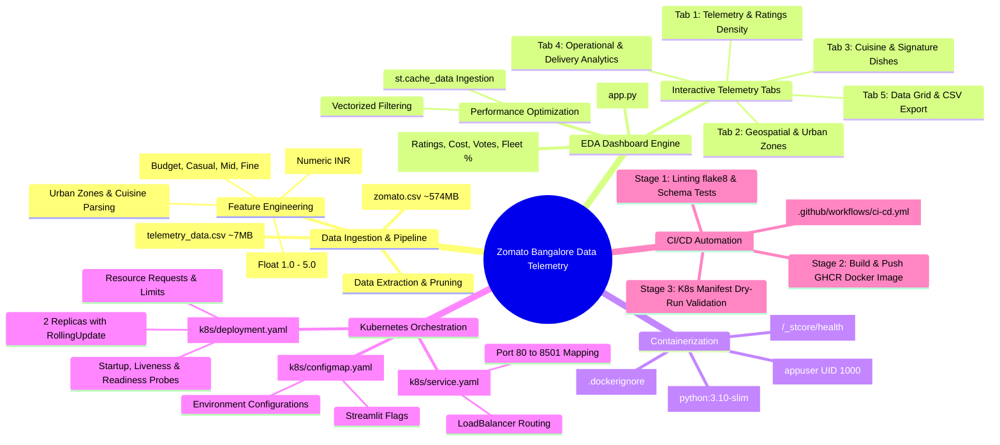
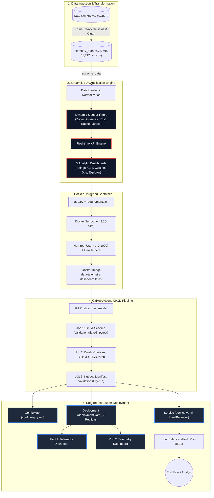

# 📊 Zomato Bangalore Data Telemetry Dashboard

A production-grade, containerized end-to-end Data Telemetry and Exploratory Data Analysis (EDA) platform built with **Streamlit**, containerized using **Docker**, orchestrated across **Kubernetes (K8s)**, and automated through a multi-stage **GitHub Actions CI/CD Pipeline**.

---

## 🧠 Architecture Mindmap



---

## 📐 End-to-End System Workflow Diagram



---

## 🗂️ Project Directory Structure

```text
data-telemetry-dashboard/
├── .github/
│   └── workflows/
│       └── ci-cd.yml             # Automated multi-stage GitHub Actions pipeline
├── k8s/
│   ├── deployment.yaml           # Kubernetes Deployment (2 replicas, health probes, limits)
│   ├── service.yaml              # Kubernetes LoadBalancer service (Port 80 -> 8501)
│   └── configmap.yaml            # Environment variables and Streamlit server configs
├── data/
│   └── telemetry_data.csv        # Cleaned high-throughput dataset (51,717 rows, 7.0 MB)
├── app.py                        # Streamlit dashboard & EDA telemetry analytics
├── requirements.txt              # Production Python dependencies
├── Dockerfile                    # Multi-stage security-hardened container specification
├── .dockerignore                 # Excludes raw large files & artifacts from Docker build
├── .gitignore                    # Prevents git tracking of heavy raw datasets & caches
└── README.md                     # Comprehensive architecture and step-by-step guide
```

---

## 📖 Step-by-Step Project Walkthrough

### Step 1: Telemetry Data Processing & Optimization
* **Challenge**: The raw source `zomato.csv` is **574 MB** due to unstructured text reviews, which creates excessive memory overhead, crashes container builds, and breaks Git repository file limits (max 100MB).
* **Solution**:
  1. Extracted essential analytical telemetry columns: restaurant names, online ordering capabilities, table booking availability, ratings, votes, locality, cuisine tags, and dining costs.
  2. Cleaned and normalized the `rate` column (converting `"4.1/5"`, `"NEW"`, and `"-"` into numeric float values `1.0 - 5.0`).
  3. Cleaned and cast `approx_cost(for two people)` from formatted strings (e.g., `"1,200"`) into floating-point numbers.
  4. Derived `cost_tier` categorical groupings:
     - **Budget**: `< ₹400`
     - **Casual Dining**: `₹400 - ₹800`
     - **Mid-Range**: `₹800 - ₹1500`
     - **Fine Dining**: `> ₹1500`
  5. Saved the clean dataset as `data/telemetry_data.csv` (**7.0 MB**, 51,717 records), achieving a **98.8% storage and memory footprint reduction**.

---

### Step 2: Exploratory Data Analysis & Streamlit Engine (`app.py`)
* **Technology**: Streamlit + Plotly Express + Pandas.
* **Architecture**:
  - **Memory Caching**: Implements `@st.cache_data` for instantaneous data ingestion and filtering across tens of thousands of records.
  - **Custom Styling**: Sleek dark-mode glassmorphism interface styled with Inter typography, vibrant neon accent badges, and responsive CSS cards.
  - **Dynamic Multi-Dimensional Filtering**:
    - Urban Zone / Sector multiselect
    - Service category (Buffet, Cafes, Delivery, Dine-out, Pubs)
    - Online order and Table booking binary filters
    - Dual-range sliders for Rating interval and Cost for two
    - Real-time cuisine keyword search
  - **5 Interactive Analytical Tabs**:
    1. **📊 Telemetry & Ratings**: Distribution histograms, Cost vs. Rating scatter plot (with bubble size mapped to votes), and Top 10 rated outlets.
    2. **🗺️ Geospatial & Zones**: Locality density bars, locality dining cost ranking, and city hub quadrant comparison.
    3. **🍲 Cuisine Telemetry**: Unrolled cuisine distribution pie charts and signature dish endorsement counts.
    4. **⚡ Operational Analytics**: Statistical box-plots analyzing the impact of delivery fleets and table booking on diner satisfaction and vote counts.
    5. **📋 Data Explorer & Export**: Paginated data grid with live schema health metrics (null tracking, memory footprint) and one-click filtered CSV download.

---

### Step 3: Docker Containerization (`Dockerfile`)
* **Base Image**: `python:3.10-slim` for minimal vulnerability surface and fast build times.
* **Hardening & Security**:
  - Enforces `PYTHONDONTWRITEBYTECODE=1` and `PYTHONUNBUFFERED=1`.
  - Creates a dedicated non-root user `appuser` (UID: 1000) to adhere to the principle of least privilege.
  - Leverages `.dockerignore` to block large raw files (`zomato.csv`), git metadata, and local cache directories.
* **Container Health Monitoring**:
  - Integrates a native container `HEALTHCHECK` probe querying `http://localhost:8501/_stcore/health` every 30 seconds.

---

### Step 4: Kubernetes Cloud-Native Orchestration (`k8s/`)
* **ConfigMap (`k8s/configmap.yaml`)**:
  - Decouples runtime configurations from container images.
  - Configures Streamlit headless mode, analytics telemetry path, and production environment flags.
* **Deployment (`k8s/deployment.yaml`)**:
  - **Replicas**: Runs 2 Pod replicas for high availability.
  - **Rolling Updates**: Zero-downtime deployments configured with `maxSurge: 1` and `maxUnavailable: 0`.
  - **Resource Management**: Defines CPU requests (`250m`) / limits (`1000m`) and memory requests (`512Mi`) / limits (`1Gi`) to avoid OOM events.
  - **Tri-Probe Lifecycle Check**:
    - `startupProbe`: Allows up to 50s for initial cache warm-up.
    - `livenessProbe`: Restarts stalled containers automatically.
    - `readinessProbe`: Directs network traffic only to healthy, ready Pods.
* **Service (`k8s/service.yaml`)**:
  - Exposes pods via a `LoadBalancer` mapping public HTTP Port `80` to container target port `8501`.

---

### Step 5: Continuous Integration & Deployment (`.github/workflows/ci-cd.yml`)
* **Trigger Conditions**: Automatically executes on pushes and pull requests to `main` or `master`.
* **Stage 1: Lint & Ingestion Validation**:
  - Sets up Python 3.10 with dependency caching.
  - Performs static code analysis with `flake8` to catch syntax defects and undefined names.
  - Runs automated schema assertion checks verifying column types and non-empty dataset states.
* **Stage 2: Build & Push Container Image**:
  - Sets up Docker Buildx with GitHub Actions layer caching (`type=gha`).
  - Authenticates securely to GitHub Container Registry (`ghcr.io`).
  - Tags and pushes the verified image using Git commit SHA and `latest` tags.
* **Stage 3: Kubernetes Manifest Validation**:
  - Uses `kubectl apply --dry-run=client` to validate syntax and schema compatibility of `configmap.yaml`, `deployment.yaml`, and `service.yaml`.

---

## 💻 How to Run the Project

### Option A: Local Execution
```bash
# 1. Install dependencies
pip install -r requirements.txt

# 2. Launch the Streamlit dashboard
streamlit run app.py
```
Visit `http://localhost:8501` in your browser.2

---

### Option B: Docker Container
```bash
# 1. Build the production Docker image
docker build -t data-telemetry-dashboard:latest .

# 2. Run container in background
docker run -d -p 8501:8501 --name telemetry-app data-telemetry-dashboard:latest

# 3. Check health probe status
curl.exe -f http://localhost:8501/_stcore/health
```

---

### Option C: Kubernetes Cluster Deployment
```bash
# 1. Deploy configuration
kubectl apply -f k8s/configmap.yaml

# 2. Deploy dashboard workload (2 Pods)
kubectl apply -f k8s/deployment.yaml

# 3. Create LoadBalancer service
kubectl apply -f k8s/service.yaml

# 4. Monitor deployment status
kubectl get pods -l app=telemetry-dashboard -w
kubectl get svc telemetry-dashboard-service
```
